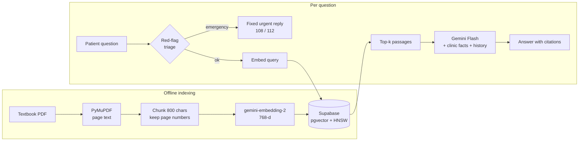

# 🧠 PhysioBOT

### A retrieval-augmented physiotherapy assistant, live on a real clinic's website

<p>
  
  
  
  
  
</p>

PhysioBOT answers patients' physiotherapy questions on the website of **Nishtha Physiotherapy** (Surat, Gujarat).
Answers are grounded in a physiotherapy textbook, cite their sources, and come back in the patient's own
language: English, Gujarati or Hindi. Questions that describe emergency symptoms skip the language model
entirely and get a fixed referral message.

> [!CAUTION]
> PhysioBOT gives general information, not a diagnosis. It is not a medical device and does not replace a
> physiotherapist, physician or emergency service.

---

## How it works



| Step | What it does | Code |
| --- | --- | --- |
| Triage | Rule-based checks for heart, stroke, cauda equina, fracture, DVT, infection and self-harm signs, in English, Gujarati and Hindi | [`physiobot/safety.py`](physiobot/safety.py) |
| Retrieval | Cosine search over pgvector with a similarity floor, so off-topic questions don't get irrelevant context | [`sql/documents.sql`](sql/documents.sql), [`physiobot/retriever.py`](physiobot/retriever.py) |
| Generation | System prompt with clinic facts, numbered passages, last 6 chat turns, and a reply in the user's language | [`physiobot/prompts.py`](physiobot/prompts.py), [`physiobot/service.py`](physiobot/service.py) |
| API | `POST /chat`, `GET /health`, CORS limited to the clinic site, per-IP rate limit | [`physiobot/api.py`](physiobot/api.py) |

### What changed from the first prototype

The first version lives on in [`NOTEBOOK/code.ipynb`](NOTEBOOK/code.ipynb). Moving it to production meant:

- **Notebook → service.** A FastAPI app with typed request/response models and 31 tests.
- **Pinecone → Supabase pgvector.** The clinic website already uses Supabase, so the vectors sit in the same
  free database: one less service and one less API key.
- **Retired models → current ones.** `text-embedding-004` and `gemini-1.5-pro` have been shut down. The bot now
  uses `gemini-embedding-2` with its asymmetric query and document prompts, and a Gemini Flash model for answers.
- **Better chunks.** 800-character chunks with overlap instead of 300, hyphen repair, and a page number on every chunk
  so answers can cite "Tidy's Physiotherapy p.214".
- **Safety first.** Deterministic red-flag triage, a no-diagnosis prompt, prompt-injection guardrails, and no
  collection of personal data.
- **Built for the clinic.** It knows the clinic's hours, fees and services, replies in Gujarati and Hindi, and the
  website shows a "Book an appointment" button under every answer.

---

## Run it locally

```bash
python -m venv .venv && source .venv/bin/activate
pip install -r requirements-dev.txt
cp .env.example .env          # add your Gemini and Supabase keys
pytest                        # 31 tests, no network needed
uvicorn physiobot.api:app --reload
```

```bash
curl -X POST localhost:8000/chat -H 'content-type: application/json' \
  -d '{"message": "What exercises help lower back pain?"}'
```

### Build the knowledge base (once)

1. In the Supabase SQL editor, run [`sql/documents.sql`](sql/documents.sql).
2. Index the PDF. It has about 3,100 chunks, and takes a few minutes on the free Gemini tier.
   **Easiest:** add the repository secrets `GOOGLE_API_KEY`, `SUPABASE_URL` and `SUPABASE_SERVICE_ROLE_KEY`
   (Settings → Secrets and variables → Actions), then open **Actions → Index textbook → Run workflow**.
   Or run it locally:

   ```bash
   python -m physiobot.ingest "Sources/Tidy's Physiotherapy.pdf" --source "Tidy's Physiotherapy"
   ```

## Deploy (free)

The repo includes a [Render blueprint](render.yaml). In Render, choose **New → Blueprint**, pick this repo, and fill
in `GOOGLE_API_KEY`, `SUPABASE_URL`, `SUPABASE_SERVICE_ROLE_KEY`, and `ALLOWED_ORIGINS` (the website's URL). Free
Render services sleep after about 15 minutes idle. The clinic website's uptime ping hits `/health` to keep it
awake, and that also runs a tiny query so the free Supabase project never counts as inactive.

## API

`POST /chat`

```json
{ "message": "ઘૂંટણના દુખાવા માટે શું કરવું?", "history": [{ "role": "user", "content": "..." }] }
```

```json
{ "answer": "...", "sources": [{ "source": "Tidy's Physiotherapy", "page": 214 }], "urgent": false }
```

`GET /health` → `{ "status": "ok", "db": "ok" }`
